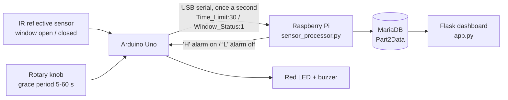

# Smart Window Energy Guard

[](https://github.com/jadenchua-dot/iot-window-energy-monitor/actions/workflows/test.yml)

An IoT prototype that stops air-conditioning from leaking out of an open window. An Arduino Uno watches the window, a Raspberry Pi decides when it has been open too long, sounds a red LED and buzzer, and logs every reading to MariaDB for a live Flask dashboard.

Built by **Jaden Chua** for the Diploma in Electronic and Computer Engineering at Nanyang Polytechnic (module EG1P54).

**🎥 Demo video:** [youtu.be/IUG_-EWEwes](https://youtu.be/IUG_-EWEwes)

## Problem

In Singapore, air-conditioning is one of the biggest users of electricity in a building. Opening a window for some fresh air is fine, but a window left open with the air-con running lets the cool air escape and wastes energy, and nobody notices until the room feels warm.

## How it works

The system acts as a smart timer for the window: you get a grace period to air the room (5 to 60 seconds, set on a knob), and only after that does it remind you to close the window.



1. **Sense.** Every second the Arduino reads the IR sensor (window state) and the rotary knob (grace period) and sends both over USB serial.
2. **Decide.** The Pi counts how many seconds in a row the window has been open. Closing it resets the count.
3. **Alert.** Once the count passes the grace period the Pi sends `H` and the Arduino turns on the LED and buzzer. `L` turns them off.
4. **Log.** Every reading goes into MariaDB with a timestamp, and the Flask dashboard shows the history, newest first, refreshing every 5 seconds.

| Window | Time open | Room status | Alert |
|---|---|---|---|
| Closed | reset to 0 | System Secure | Alert: OFF |
| Open | within the grace period | Open | Alert: OFF (Ventilating) |
| Open | past the grace period | Open | Alert: ON (Time Exceeded!) |

## Hardware

| Part | Role |
|---|---|
| Arduino Uno | Reads the sensors, drives the alarm |
| Grove infrared reflective sensor | Window open or closed (D2) |
| Grove rotary angle sensor | Grace period, mapped to 5-60 s (A0) |
| Red LED | Visual alarm (D13) |
| Buzzer | Audible alarm (D3) |
| Raspberry Pi | Timing logic, database and web dashboard |

## Software

| Part | Tech |
|---|---|
| `arduino/window_sensor.ino` | Arduino C++: sensor readings out, alarm commands in |
| `python/sensor_processor.py` | Python 3 + pySerial: timing logic, alarm commands, database logging |
| `python/app.py` + `python/templates/` | Flask + Jinja: the dashboard |
| `schema.sql` | MariaDB database, user and table |

## Run it

On the Raspberry Pi, with the Arduino plugged in over USB:

```bash
git clone https://github.com/jadenchua-dot/iot-window-energy-monitor.git
cd iot-window-energy-monitor
python3 -m venv .venv && . .venv/bin/activate
pip install -r requirements.txt
sudo mariadb < schema.sql                   # database, user and table (run once)

python3 python/sensor_processor.py          # terminal 1: the logic and logger
FLASK_HOST=0.0.0.0 python3 python/app.py    # terminal 2: dashboard on http://<pi-address>:5000/
```

Upload `arduino/window_sensor.ino` to the Uno from the Arduino IDE first.

**Settings.** The defaults match the lab setup. Override any of them with environment variables:

| Variable | Default |
|---|---|
| `SERIAL_PORT` | `/dev/ttyACM0` |
| `DB_HOST`, `DB_NAME` | `localhost`, `Part2Data` |
| `DB_USER`, `DB_PASSWORD` | the lab defaults in `schema.sql` (change both outside a lab) |
| `FLASK_HOST` | `127.0.0.1` (use `0.0.0.0` to open the dashboard from another device) |

## Testing

`python/test_sensor_processor.py` replays a recorded serial stream against a fake serial port and a fake database. It checks that:

- readings are matched by name, so a capture that starts halfway through a line (which happens when the Pi opens the port while the Arduino is already sending) is skipped instead of crashing the logger,
- the alarm turns on only after the window has been open longer than the grace period, and off again as soon as it closes,
- the alarm is switched off when the logger stops.

```bash
python -m unittest discover -s python -v
```

GitHub Actions runs these tests and renders the dashboard with a fake database on every push.

## Files

```text
iot-window-energy-monitor/
├── arduino/
│   └── window_sensor.ino          Arduino Uno: sensors in, alarm out
├── python/
│   ├── sensor_processor.py        Raspberry Pi: logic, alarm commands, logging
│   ├── app.py                     Flask dashboard
│   ├── templates/sql-data.html    dashboard page
│   └── test_sensor_processor.py   unit tests
├── schema.sql                     MariaDB setup
└── requirements.txt               Python packages
```

## Next steps

- Read the air-con's state (for example with a current sensor) so the alarm only sounds when cooling is actually running.
- Count time from the Pi's clock instead of one tick per reading.
- Push a phone notification as well as sounding the buzzer.
